<div align="center">

<h1></h1>

**Ask the textbook. Get answers cited to the page.**

An AI study assistant built on retrieval-augmented generation (RAG), with its own evaluation harness, **Dyno**, that measures every change to retrieval.

[**Live demo**](https://recall-nine-cyan.vercel.app/) · [**Dyno results**](https://recall-nine-cyan.vercel.app/dyno) · [How it works](#how-a-question-becomes-a-cited-answer) · [Architecture](#architecture) · [Decisions](#design-decisions)

[](https://github.com/AmaanAli1/recall/actions/workflows/web.yml)
[](https://github.com/AmaanAli1/recall/actions/workflows/api.yml)
[](https://github.com/AmaanAli1/recall/actions/workflows/db.yml)

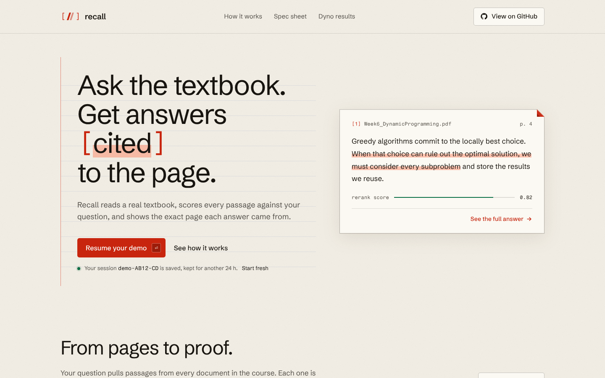

</div>

---

## Contents

- [What it does](#what-it-does)
- [Results](#results-measured-not-claimed)
- [Architecture](#architecture)
- [How a question becomes a cited answer](#how-a-question-becomes-a-cited-answer)
- [How a textbook becomes searchable](#how-a-textbook-becomes-searchable)
- [Dyno: the evaluation harness](#dyno-the-evaluation-harness)
- [Complexity and cost](#complexity-and-cost)
- [Security model](#security-model)
- [AWS and deployment](#aws-and-deployment)
- [Environments](#environments)
- [Design decisions](#design-decisions)
- [Testing and quality engineering](#testing-and-quality-engineering)
- [Run it locally](#run-it-locally)
- [Repository layout](#repository-layout)
- [Known limits](#known-limits)
- [Credits](#credits)

---

## What it does

You ask a question about **Jeff Erickson's *Algorithms*** (four chapters: recursion, dynamic programming, greedy algorithms, shortest paths). Recall:

1. **finds** the passages in the book that best match your question,
2. **answers only from those passages**, with every claim cited to its page,
3. **says so** when the book doesn't cover your question, instead of guessing,
4. **shows its work**: the quoted sentence on each page, the similarity score, and the weak matches it dropped.

Follow-up questions work too ("why does *it* fail with negative edges?"): Recall rewrites them to stand alone before searching.

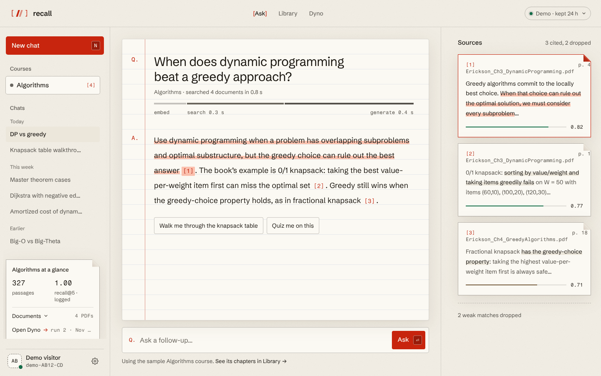

> [!NOTE]
> **The public demo is deliberately scoped to one openly licensed textbook.** There are no visitor uploads. See [why](#why-one-textbook-and-no-uploads).

---

## Results: measured, not claimed

Every number below comes from **Dyno**, run against the live pipeline's database, and states its sample size. Full results, including every question, are on the [Dyno page](https://recall-nine-cyan.vercel.app/dyno).

| Question set | n | Metric | Result (95% interval) |
|---|---:|---|---|
| Core questions | 20 | **Recall@5** (right page in the top 5) | **20 / 20** |
| Core questions | 20 | **MRR** (how high the right page ranks; 1.0 = always first) | **0.76** (0.63–0.89) |
| Follow-ups, as typed | 8 | MRR | 0.20 (0.07–0.35) |
| Follow-ups, **rewritten** | 8 | MRR | **0.92** (0.75–1.00) |
| Off-topic questions | 5 | Turned away by retrieval | 3 / 5 |

**What these numbers say:**

- **Query rewriting works on follow-ups:** MRR went from 0.20 to 0.92, and the intervals don't overlap even at n = 8. The core 20 questions scored identically, rank for rank, in both runs, which also shows Dyno is repeatable.
- **The off-topic result is the honest one:** the strongest off-topic match (0.53, a red-black tree question the book's exercises partly cover) scored *above* the weakest real match (0.52). **No single similarity threshold can separate them**, so the threshold stays at 0.25 and the answer model is the second guard. In a live check it cited the three facts the book does contain and said the rest wasn't described. It invented nothing.
- **Caveats:** the follow-ups were written by me, so they show rewriting works on clear cases. Faithfulness (does every claim match its passage?) isn't measured yet; it needs an LLM judge (Dyno v1).

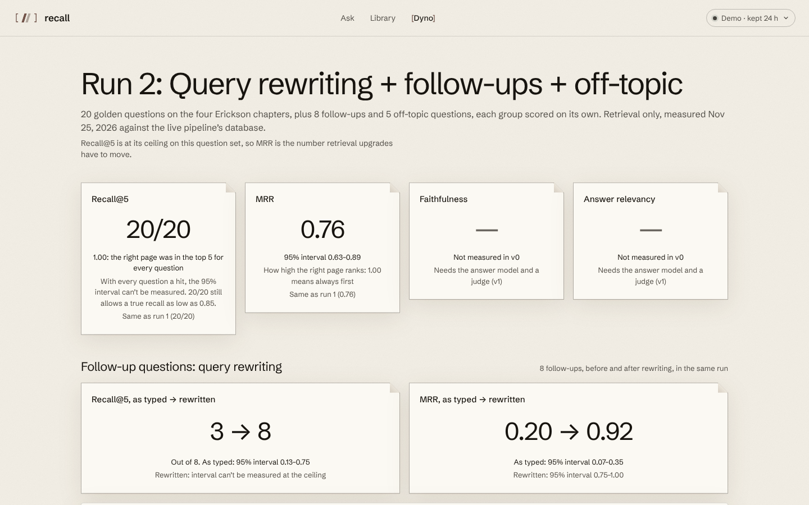

---

## Architecture

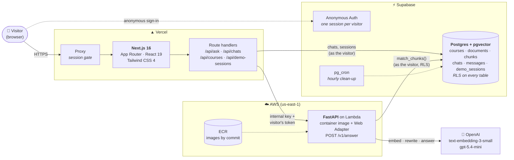

| Layer | Technology | Why it's there |
|---|---|---|
| Frontend | **Next.js 16** (App Router), React 19, TypeScript, Tailwind CSS 4 | Server route handlers keep secrets off the browser; the proxy gates pages server-side |
| RAG service | **Python 3.12, FastAPI**, Pydantic, uv | The ML ecosystem lives in Python; typed models validate every request and model reply |
| Vector store | **Supabase Postgres + pgvector** | One database for app data *and* embeddings, so row-level security covers retrieval too |
| Models | **OpenAI** `text-embedding-3-small` (1536-d), `gpt-5.4-mini` | Cheap, fast, structured outputs |
| Hosting | **Vercel** (web), **AWS Lambda** (API, container image) | Pay-per-request; idle costs nothing |
| CI/CD | **GitHub Actions**, OIDC to AWS | Required checks on every PR; deploys with no stored cloud keys |

---

## How a question becomes a cited answer

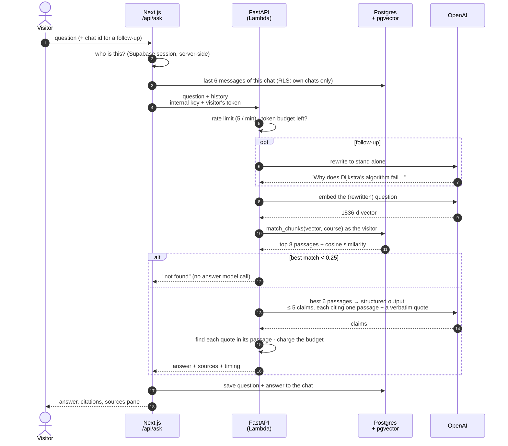

**The details that matter:**

| Step | Decision | Why |
|---|---|---|
| History | Loaded **server-side from the database**; anything the browser sends as history is ignored | Conversation text is untrusted, and a client could forge it |
| Rewrite | One small structured call on the last 3 turns; on any failure, **fall back to the original question** | An optional step should improve follow-ups, never break them |
| Search | `match_chunks()` runs **as the visitor**, so row-level security decides what's searchable | The API holds no database password at all |
| "Not found" | If the best similarity is below **0.25**, no answer model is called | Off-topic questions cost a few tokens, and the model can't improvise |
| Answer | Structured output: each claim cites **exactly one passage** and gives a **verbatim quote** | Every citation can be checked against a real page, and the UI highlights the quoted sentence |
| Budget | 50,000 tokens per session, charged after each answer | Caps what one visitor can spend |

---

## How a textbook becomes searchable

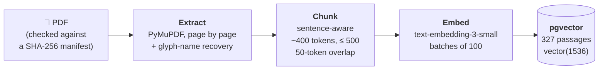

- **Extraction** keeps page numbers, which is what makes page-level citations possible. Erickson's PDFs use fonts whose characters have no Unicode mapping; the extractor recovers them from the font's glyph names (2,038 characters that would otherwise have been dropped).
- **Chunking** splits on sentences, aims for ~400 tokens (hard cap 500), and carries 50 tokens of overlap so an idea split across two passages is still findable. Pages under 40 tokens are skipped.
- **Each embedding input includes the document name**, so a passage "knows" which chapter it came from.
- The ingest script is **generic**: it takes any text-based PDF. It refuses to run unless `--ref` matches the database it's connected to, so staging can't be confused with production.

---

## Dyno: the evaluation harness

> *"If you can't measure it, you can't improve it."* Dyno is how Recall knows whether a change to retrieval helped.

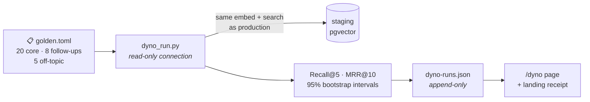

- **The golden set is fixed.** Each question is labelled with the document and page that answer it, checked by hand against the book. Once a run uses a question, it's never reworded to raise a score; new questions get new ids.
- **Groups are scored separately, never averaged.** Core, follow-ups (as typed *and* rewritten, in the same run) and off-topic questions each get their own numbers.
- **Every number carries its uncertainty.** With 20 questions, one question moves MRR by 0.05, so each metric gets a 95% bootstrap interval (1,000 resamples, fixed seed, so reruns are identical).
- **Runs are append-only** and written only by the script. Each run records the commit it measured, because its purpose is to say whether a *code change* helped.
- **Contract tests** keep the Python script and the website in sync: the site validates the runs file's shape at build time, and a test compares the page's question text with `golden.toml` word for word.

---

## Complexity and cost

**Per question** (with *N* = 327 passages, *d* = 1536 dimensions):

| Work | Cost | Notes |
|---|---|---|
| Model calls | **1 embedding + 0–1 rewrite + 0–1 answer** | No rewrite for a first question; no answer model for "not found" |
| Vector search | **O(N · d)** ≈ 502,000 multiply-adds | An exact scan: sub-millisecond at this size |
| Vectors in memory | N × d × 4 bytes ≈ **2 MB** | Fits in cache; no index needed |
| Answer size | ≤ 8 passages retrieved, ≤ 6 sent, ≤ 5 claims, ≤ 800 output tokens | Hard caps per request |
| History | the last 6 messages (3 turns), each ≤ 600 chars to the rewriter | Bounded prompt size, whatever the chat length |

**Ingest:** O(pages + passages) to extract and chunk; ⌈327 / 100⌉ = **4 embedding calls** for the whole book.

**Why no approximate-nearest-neighbour index (HNSW / IVFFlat)?** At 327 passages, an exact scan is fast and returns the *true* nearest neighbours. An ANN index trades a little recall for speed, which only pays off at tens of thousands of vectors and up. If the corpus grew, an HNSW index is a one-line migration, and Dyno would measure whether recall dropped.

**Running cost:** Lambda bills per request, and its always-free tier covers tens of thousands of answers, so the API costs about **$0** at demo traffic. The hard caps: a **$10** monthly limit on the OpenAI project and a **$5** AWS budget alarm.

---

## Security model

Recall is a public, anonymous demo, so it's built as **defence in depth**: each layer assumes the one before it might fail.

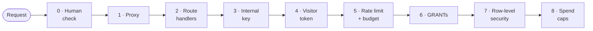

| # | Layer | What it stops |
|---|---|---|
| 0 | **Human check** (new sessions only) | Cloudflare Turnstile in Managed mode on "Try the demo"; the one-time token is verified by Supabase Auth, so scripts can't mint sessions (each with its own token budget). No token → 400 before Supabase is called; a forged or reused one → 400 |
| 1 | **Proxy** (session gate) | No session → 307 to `/demo`; `?next=` only through `safeNext()`, so no open redirects |
| 2 | **Route handlers** | Identity comes from `getClaims()`, never from the client; bodies are validated, never passed straight to the database |
| 3 | **Internal key** | Only the Next.js server can call the API |
| 4 | **Visitor token** | The API acts *as the visitor*; it holds no database password |
| 5 | **Rate limit + token budget** | 5 questions a minute; 50,000 tokens per session |
| 6 | **Postgres GRANTs** | Explicit, least privilege, pinned by tests; courses are read-only for visitors |
| 7 | **Row-level security** | On every table: you see only your own rows and the shared course |
| 8 | **Spend caps** | OpenAI monthly hard limit; AWS budget alarm |

- **The service-role key is never used by the app.** The only key in the browser is Supabase's publishable key; every query runs as the visitor, so RLS applies everywhere, including vector search.
- **Every table has explicit GRANTs**, pinned by tests, so each database (CI, staging, production) matches whatever defaults Supabase applies.
- **Text from PDFs and chat history is untrusted data**: it's passed to the model as data, never as instructions.
- **Sessions expire:** a `pg_cron` job runs hourly and deletes sessions idle for 24 hours, with their chats.
- **Previews never touch production:** Vercel preview deploys use a separate staging database and staging Lambda.

---

## AWS and deployment

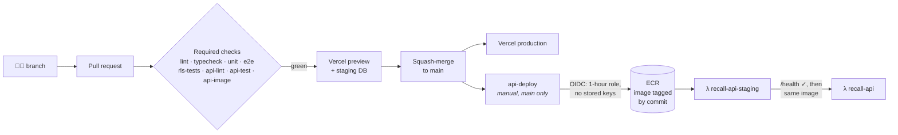

- **The API is one Docker image** (Python 3.12 slim, non-root user, uv-locked dependencies). The **AWS Lambda Web Adapter** lets the same FastAPI server run on Lambda unchanged, and outside Lambda it does nothing.
- **Images are tagged by commit and immutable**, so production runs exactly the image staging tested. CI checks that the image starts with no secrets, contains no secrets, PDFs or tests, and runs as the non-root user.
- **No long-lived AWS keys exist.** GitHub's OIDC token is exchanged for a one-hour role that trusts only this repo's `main` branch and can only push one image and update two functions.
- **Database changes are migrations**, each shipped with pgTAP tests, pushed to staging, verified, then pushed to production.

---

## Environments

Four environments, each with its **own database and its own API**. Nothing outside production can read or write production data.

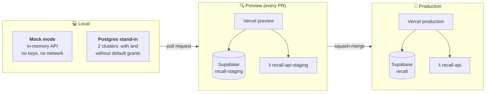

| | Local (mock) | Local stand-in | Preview | Production |
|---|---|---|---|---|
| **Frontend** | `next dev` / `next start` | n/a | Vercel preview, one per PR | Vercel production |
| **Database** | none: an in-memory mock API | Postgres 16 + pgvector + pg_cron + pgTAP, two clusters | Supabase **staging** | Supabase **production** |
| **RAG API** | none | the real script entry points | Lambda **staging** | Lambda **production** |
| **Used for** | UI work, Vitest, Playwright | pgTAP on both database flavours; end-to-end runs of the ingest and Dyno scripts | Reviewing a PR on real data; verifying migrations before production | Visitors |
| **Secrets** | none | none | staging keys only | production keys only |

**How the environments stay honest:**

- **Feature flags, not branches.** `NEXT_PUBLIC_REAL_SESSIONS`, `NEXT_PUBLIC_REAL_CHATS` and `NEXT_PUBLIC_REAL_ASK` switched each layer from the mock to the real backend one at a time, so the UI shipped and was tested long before the backend existed. `NEXT_PUBLIC_` values are baked in at build time, so a flag is always turned on in **Preview first**, tested, then in Production.
- **Staging and production are deliberately different Supabase projects**, and they differ in one way that matters: production (an older project) has Supabase's **default table grants**, staging doesn't. A permissions bug once surfaced only on staging (`42501`, permission denied), because the code had silently relied on those defaults. Since then every table gets **explicit GRANTs pinned by tests**, and the local stand-in runs every pgTAP test on **both flavours**: one cluster with default grants, one without.
- **Migrations go staging → verify → production → verify**, with verification queries copied from the schema, and the CLI's linked project checked before every push.
- **Each Lambda has its own internal key**, so a staging key can't call production.
- **A standby switch** (`NEXT_PUBLIC_DEMO_STANDBY`) can close the public demo in production with an environment variable and a redeploy, no code change, while previews keep working.

---

## Design decisions

<details open>
<summary><b>Why one textbook, and no uploads?</b></summary>

<a id="why-one-textbook-and-no-uploads"></a>

It's a deliberate scope decision. A free, anonymous public demo would carry the cost and abuse risk of strangers' files: storage and OCR bills anyone can run up, malicious or huge files, private documents on my server, and copyrighted textbooks uploaded by visitors. So the demo focuses on **measurable retrieval quality over one openly licensed textbook**.

A fixed corpus is also what makes the evaluation meaningful: Dyno's golden questions are labelled against those exact pages. Uploads were designed (signed upload URLs straight to storage, server-side checks for real PDFs, page and size caps, OCR for scans, deleting files after processing) and then cut on purpose.

**Does it only work on that one book?** No. The ingest pipeline is generic: I ran it myself to load the chapters, and Dyno would measure any new course the same way, once it has a golden set.

</details>

<details>
<summary><b>Why Erickson's <i>Algorithms</i>?</b></summary>

It's **CC BY 4.0**, so it can be shared and quoted with attribution, and it's a real textbook students actually use. Another open textbook was evaluated and dropped: its maths is drawn as vector images, so text extraction silently lost every number ("Write the &nbsp; in the tens place"). The lesson: check extraction *quality* on real pages, not just whether text exists.

</details>

<details>
<summary><b>Why pgvector in Postgres instead of a dedicated vector database?</b></summary>

One database means one security model. Embeddings sit next to the rows that own them, so the same row-level security policies that hide another visitor's chats also decide what retrieval can search. At this scale, Postgres is more than fast enough, and there's one less service to run, pay for and secure.

</details>

<details>
<summary><b>Why AWS Lambda instead of an always-on container service?</b></summary>

I priced it first. ECS with an always-on load balancer would have cost about **$37 a month**, most of it the load balancer billed every hour. Lambda bills per request, and its free tier covers this demo, so it costs about $0. The trade-offs I accepted: a cold start of a few seconds after idle, and the in-memory rate limit is per Lambda instance (the database token budget still caps spending).

</details>

<details>
<summary><b>Why rewrite follow-up questions?</b></summary>

Search only sees the words you type. "Why does it fail with negative edges?" doesn't mention Dijkstra, so it matched weak passages or nothing. One small model call rewrites it to stand alone, and both search and the answer model use the rewrite. Dyno measured the effect: follow-up MRR rose from 0.20 to 0.92. The UI shows "Searched for …" so you can see what was actually searched.

</details>

<details>
<summary><b>Why keep the 0.25 threshold when it lets two off-topic questions through?</b></summary>

Because the data says no threshold works: the strongest off-topic match (0.53) scored above the weakest on-topic one (0.52). Raising the threshold would turn away real questions. The answer model is the second guard: it may only state what the passages say, and it says when they don't cover something.

</details>

<details>
<summary><b>Why anonymous sessions instead of accounts?</b></summary>

A recruiter or student should be able to try it in one click. Supabase's anonymous sign-in gives every visitor a real user id, so row-level security works exactly as it would with accounts. Sessions and their chats are deleted after 24 hours idle.

</details>

---

## Testing and quality engineering

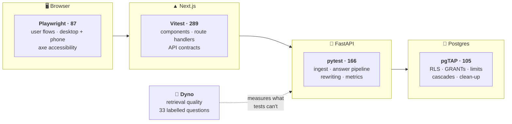

| Suite | Count | What it covers |
|---|---:|---|
| **pgTAP** | 105 | Row-level security (one visitor attacking another's rows), exact GRANTs per role, per-session limits, cascades, the hourly clean-up. Each file runs in a transaction that's rolled back |
| **pytest** | 166 | PDF extraction and glyph recovery, chunk boundaries, embedding batches, the answer endpoint's every error path (401 / 422 / 429 / 502 / 503), rewriting and its fallback, rate limiting, Dyno's metrics and bootstrap |
| **Vitest** | 289 | Components, route handlers (with Supabase faked), the API contract shared by the mock and the real client, the runs file's shape |
| **Playwright** | 87 | End-to-end flows at desktop and phone width, axe accessibility audits (WCAG 2.1 A/AA) on every screen, no sideways scroll at 390 px |
| **Dyno** | 33 questions | Not a pass/fail test: it measures retrieval quality, so changes are judged on numbers, not impressions |

### The CI gate

Every pull request must pass **8 required checks** before it can merge into a protected `main`. Path filters skip suites a change can't affect, so a README change doesn't rebuild the API image.

| Check | What it runs |
|---|---|
| `lint` · `typecheck` | ESLint; `next typegen` + `tsc --noEmit` |
| `unit` | Vitest |
| `e2e` | a production build, then Playwright on Chromium |
| `rls-tests` | a throwaway Supabase (`supabase start`), every migration, then `supabase test db` |
| `api-lint` · `api-test` | `ruff check` + `ruff format --check`; pytest, with `uv sync --locked` |
| `api-image` | builds the Docker image, starts it **with no secrets** and checks `/health`, checks no secrets, PDFs or tests are inside, and that it runs as the non-root user |

### How the tests are kept honest

Passing tests only mean something if they would have failed on broken code. The habits behind these suites:

- **Every new test fails first.** New Playwright tests are run against the old code (in a separate `git worktree`) to prove they detect the change; new pgTAP tests are run once *without* the new migration.
- **Planted bugs (manual mutation testing).** Before each PR, deliberate bugs are introduced: an off-by-one in a threshold, a dropped grant, a kept policy, a renamed link. Every one must make a test fail. When one slipped through, a test was added; twice, the "bug" turned out to be dead code, which was deleted.
- **Boundary values get data *at* the boundary:** similarity 0.249 / 0.25 / 0.3 around the 0.25 threshold, not just "high" and "low".
- **Assert the right error, not just an error.** A test expecting `check_violation` once passed for the wrong reason, because a different rule raised the same code first. Tests now check the code *and* set up state so only the rule under test can fire.
- **Contract tests at every boundary between programs:** the website validates the Python script's JSON at build time, and a test compares the page's question text with `golden.toml` word for word, so the two programs can't drift apart.
- **Run the real entry point end to end** when unit tests can't reach the wiring. Running the Dyno script against a local Postgres loaded with the real 327 passages found a bug that would have made every real run refuse to start, after all unit tests had passed.
- **Reproduce before fixing.** A bug that only appeared on the Vercel preview (a prefetched redirect cached before the session existed) was reproduced locally with a fake Supabase auth server and a forged session cookie, then fixed and verified in the same setup.
- **Look at the result.** Every visual change is checked in screenshots at desktop and 390 px; a test can't tell you a link doesn't look like a link.

### Engineering principles

| Principle | Where it shows |
|---|---|
| **Least privilege** | Explicit GRANTs per table; the API holds no database password; a deploy role that can push one image and update two functions |
| **Defence in depth** | 9 security layers, each assuming the previous one failed; browser checks are UX, the database enforces the same rule |
| **Fail open for optional steps, fail closed for security** | A failed rewrite falls back to the original question; a failed auth check returns 401 |
| **Untrusted input stays data** | PDF text and chat history are passed to the model as data; history is loaded server-side, never from the browser |
| **Small, reviewable changes** | GitHub Flow, one short-lived branch per change, squash-merged with Conventional Commit titles |
| **Reproducible builds** | Locked dependencies (`uv.lock`, `package-lock.json`); images tagged by commit, built once, promoted from staging to production unchanged |
| **Measure, don't guess** | Dyno for retrieval quality, with sample sizes and intervals on every number; prices compared before choosing a host |
| **No made-up numbers** | Unmeasured metrics show "not measured", not a placeholder; small samples say so |

---

## Run it locally

**Frontend** (runs on a built-in mock API by default, no keys needed):

```bash
cd web
cp .env.example .env.local
npm ci
npm run dev                      # http://localhost:3000
```

**RAG service:**

```bash
cd api
cp .env.example .env             # Supabase URL + publishable key, OpenAI key, internal key
uv sync
uv run pytest
uv run fastapi dev src/recall_api/main.py   # http://127.0.0.1:8000/health
```

**Checks** (the same ones CI runs):

```bash
cd web && npm run lint && npm run typecheck && npm run test:unit && npm run build && npm run test:e2e
cd api && uv run ruff check && uv run ruff format --check && uv run pytest
```

**Dyno** (from `api/`, with a read-only database URL):

```bash
uv run python -m recall_api.scripts.dyno_run --dry-run
uv run python -m recall_api.scripts.dyno_run --ref <project-ref> --change "What changed"
```

---

## Repository layout

```
recall/
├── web/                  Next.js app
│   ├── src/app/          pages (landing, /demo, /ask, /library, /dyno) + route handlers (/api/*)
│   ├── src/lib/          API contract, mock API, Supabase clients
│   ├── src/data/         dyno-runs.json (written only by the Dyno script)
│   └── e2e/              Playwright tests
├── api/                  FastAPI RAG service (Python 3.12, uv)
│   ├── src/recall_api/
│   │   ├── main.py       POST /v1/answer, step by step
│   │   ├── answer.py     prompt, structured output, quote finding
│   │   ├── rewrite.py    follow-up rewriting
│   │   ├── ingest/       pdf.py · chunk.py · embed.py
│   │   ├── dyno/         golden-set loader, metrics
│   │   └── scripts/      ingest_samples.py · dyno_run.py
│   └── Dockerfile        the image that runs on Lambda
├── dyno/golden.toml      the golden questions
├── supabase/
│   ├── migrations/       schema, RLS, GRANTs, functions, pg_cron
│   └── tests/database/   pgTAP tests
└── .github/workflows/    web · api · db · api-deploy · keepalive
```

---

## Known limits

- **One course**, by design ([why](#why-one-textbook-and-no-uploads)).
- **Retrieval-only evaluation:** faithfulness and answer relevancy need an LLM judge (Dyno v1, not built).
- **No reranker or hybrid search yet:** vector search only. Both are natural next steps, and Dyno would measure them.
- **The rate limit is per Lambda instance** (in memory); the per-session token budget in the database is the real cost cap.
- **A visitor can add messages to their own chats directly** through Supabase's API, with their own session token. The app never accepts an answer from the browser (saving happens on the server, in `/api/ask`), but the database can't tell the server and the browser apart: both act *as the visitor*. Closing that completely would mean giving the server a key that bypasses row-level security, a far bigger risk than this one. Accepted, because such messages only ever reach that visitor's own chats, which nobody else can see, and the per-chat and per-message limits still apply.
- **Small samples:** 20 core and 8 follow-up questions. Every result states its n and its interval for that reason.

---

## Credits

- **Textbook:** Jeff Erickson, [*Algorithms*](https://jeffe.cs.illinois.edu/teaching/algorithms/book/), licensed under [CC BY 4.0](https://creativecommons.org/licenses/by/4.0/). Chapters 1, 3, 4 and 8 are used unmodified as the demo's course; the PDFs are not stored in this repository.
- **Code:** [MIT License](LICENSE).
- Built by **Amaan Ali** ([@AmaanAli1](https://github.com/AmaanAli1)), Computer Science at Wilfrid Laurier University.
